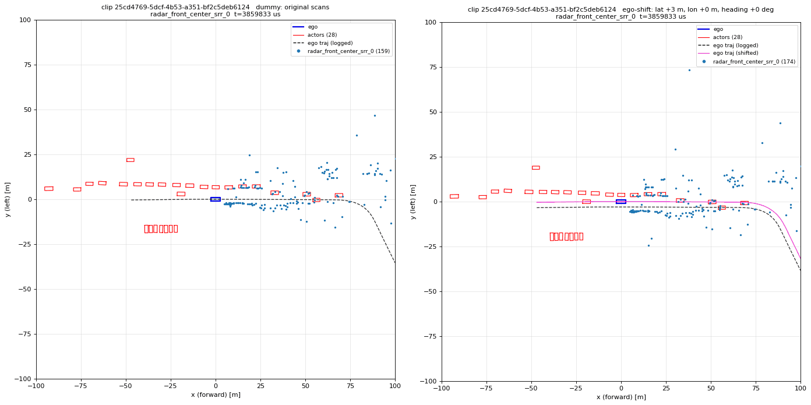
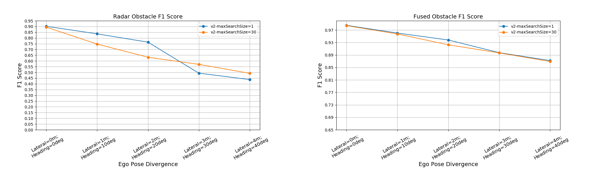

# Radar Reprojection

NVIDIA Radar Reprojection is a simulation capability that updates recorded radar returns and Doppler estimates for simulated vehicle poses, supporting closed-loop sensor-fusion evaluation. It separates static scene points from moving actors and transforms recorded measurements as vehicle and actor poses change. It reuses measured radar returns, with pose variation limited by the viewpoints captured in the recording.

## Support

* **Usage questions and discussion:** Ask about Radar Reprojection on the [NVIDIA Developer Forum (Omniverse / NuRec)](https://forums.developer.nvidia.com/c/omniverse/platform/nurec/752).
* **Code-level bugs, documentation issues, and feature requests:** File a [GitHub issue](https://github.com/NVIDIA/radar-reprojection/issues/new/choose) using the Bug report, Documentation request, or Feature request template. The NVIDIA support responder is assigned automatically.
* **Security vulnerabilities:** Use [NVIDIA's Vulnerability Disclosure Program](https://app.intigriti.com/programs/nvidia/nvidiavdp/detail). Do not report vulnerabilities in public issues.

## Key Features

* **Data-Driven Simulation:** Generates realistic radar signals based on original sensor data.
* **Production-Grade Roots:** Migrated directly from the NVIDIA NDAS production simulation system.
* **Standalone Build:** Compiles independently using Bazel (`bzlmod` on Linux).
* **Open Dataset Integration:** Native support for the open [PhysicalAI-Autonomous-Vehicles](https://huggingface.co/datasets/nvidia/PhysicalAI-Autonomous-Vehicles) dataset format.
* **Hybrid Execution:** Runs efficiently on the CPU while pairing seamlessly with GPU-based NuRec rendering libraries and simulation pipelines.

## Visual Example

Below is a side-by-side visual comparison (**Left:** Original log | **Right:** Closed-loop simulation). Despite a 3-meter lateral shift in the ego vehicle's trajectory (the purple path in the right frame), the reprojection algorithm generates highly consistent radar points across all timestamps—yielding near-identical object detection and tracking results in the NVIDIA NDAS system.

  

## Ablation Study

Evaluating quantitative performance for the radar reprojection algorithm depends heavily on the specific radar hardware and downstream perception pipeline, making a single benchmark metric impractical. Instead, we present an ablation study using our internal NDAS perception system to evaluate algorithmic robustness against ego pose divergence — a common issue in closed-loop simulations.

The plots below illustrate how synthetic ego-pose divergence (ranging from baseline to extreme conditions, such as 4 meters of lateral offset and a 40-degree heading change) affects 3D bounding-box obstacle detection ([F1 score](https://en.wikipedia.org/wiki/F-score)):

* **Radar-Only:** F1 scores drop from 90% down to ~49%. (Note: "V2" is the latest open-source release, and `maxSearchSize` denotes the number of temporal frames used for multi-frame search; `maxSearchSize=30` is the recommended setting.)
* **Fused Camera + Radar:** Because radar is rarely used in isolation, pairing it with NuRec-rendered camera frames significantly buffers performance loss, keeping fused F1 scores between 98% and 87% across the same range.

**Key Takeaways**
The radar reprojection algorithm maintains reliable accuracy within normal ranges of ego pose divergence. However, supporting extreme pose errors with high robustness will require further algorithm extension, such as integration with generative Diffusion models.

  

## Documentation & Quick Start

* **[`algorithm/README.md`](algorithm/README.md):** Deep dive into the reprojection algorithm, adaptive multi-frame sampling, and the view-selection model.
* **[`docs/USAGE.md`](docs/USAGE.md):** Detailed instructions for building and running the library.
* **[`SKILL.md`](SKILL.md):** Context file for AI coding assistants to help automate integration into your existing codebase.

## Project Policies

This project is currently not accepting contributions.

* [License](LICENSE)
* [Contribution Policy](CONTRIBUTING.md)
* [Code of Conduct](CODE_OF_CONDUCT.md)
* [Security Policy](SECURITY.md)
* [Third-Party Licenses](THIRD_PARTY_LICENSES.md)
